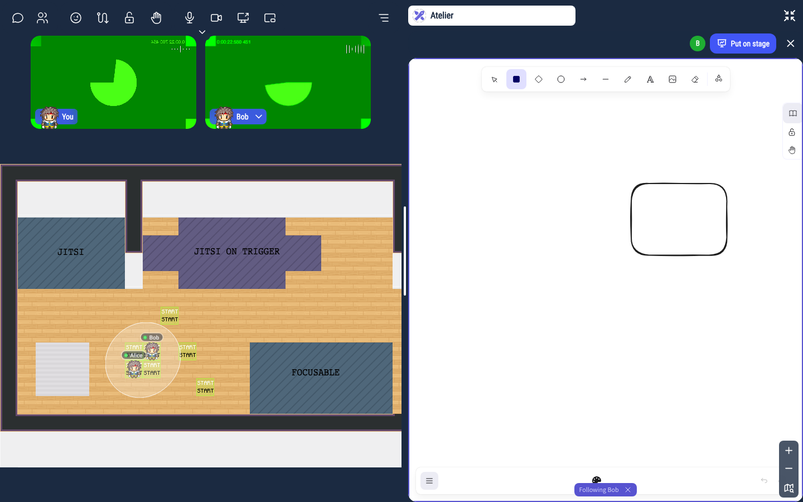
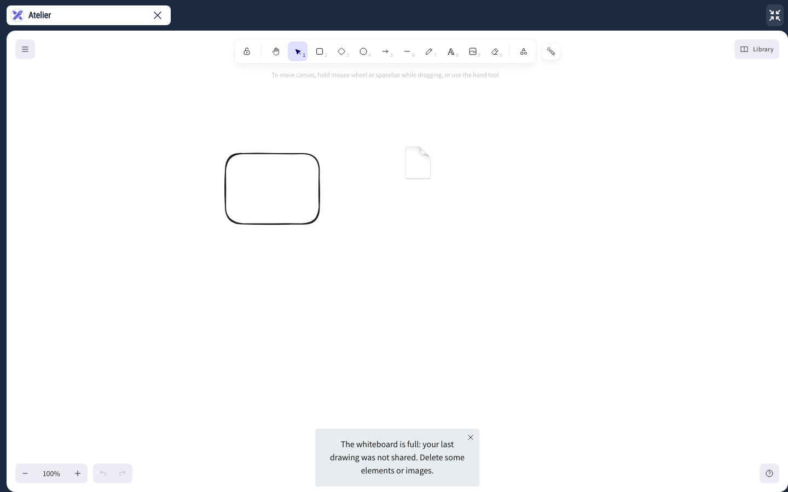
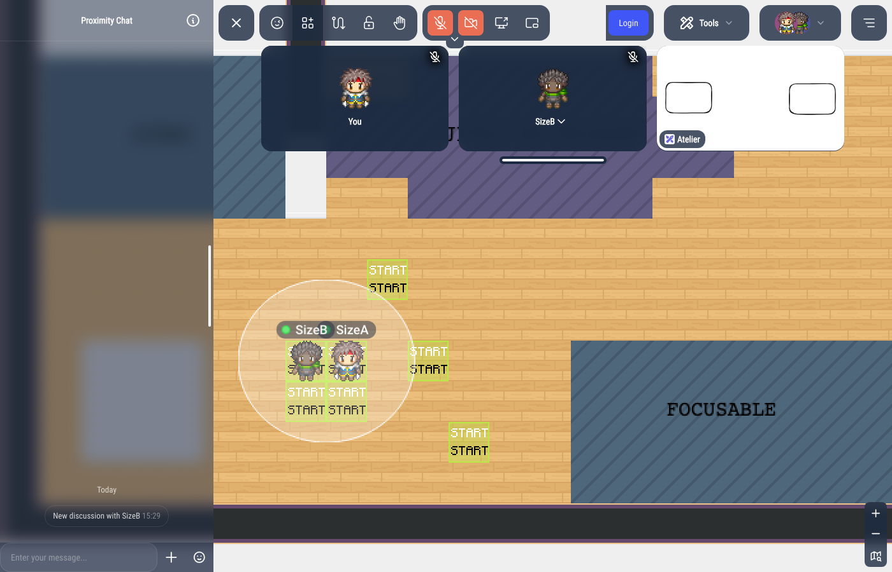
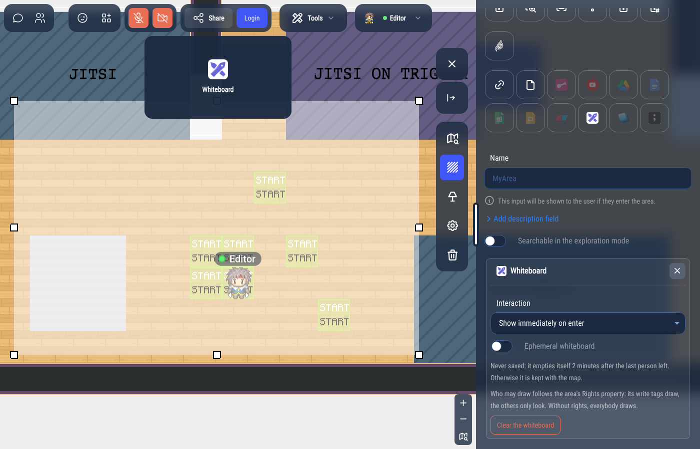

---

sidebar_position: 95

---

# Whiteboard

## Description

The whiteboard property attaches a collaborative whiteboard to an area. Everybody standing in the area draws on the same board, sees the others' drawings as they draw, and sees their cursors with their names.

The whiteboard is [Excalidraw](https://excalidraw.com), drawn by WorkAdventure itself: there is no external website and no extra service to install. Drawings go through the WorkAdventure server only.

The board opens in a panel beside the map, with the name of the area as its title: you prepare it while you keep seeing the map.

When a meeting starts, click **Put on stage** in the board's header: the board moves to the middle of the screen, under the cameras, and stays there while you walk around the area. The header shows who is on the board (click someone to follow their view), puts the board fullscreen with the cameras in a strip on the side, brings it **Back to the panel**, or closes it. The board remembers your choice the next time you open it.

On stage, when you shrink the board to a tile among the cameras, the tile shows a live picture of the board and its name: you see what the others draw without opening it. Click the tile to bring the board back.

## Add a whiteboard to an area

While editing an area, select the "Whiteboard" property. You can choose when the board opens:

- **Show immediately on enter**: the board opens as soon as somebody walks into the area.
- **On action**: a message invites the user to press a key to open it. You can customize that message.

While the map editor is open, a board on stage shrinks to a tile among the cameras, so that it does not hide the map.

## Saved with the map

The board is kept with the map: walk out and come back the next day, it is still there. It is saved every few seconds while people draw, and as soon as the last person leaves. Deleting the area, the whiteboard property or the map deletes the board.

Turn on **Ephemeral whiteboard** for a board that is never saved: it empties itself 2 minutes after the last person left.

A board holds up to 15 MB of drawings. Past that, what you just drew is not shared and a message says the board is full: delete some elements or images, or export the board.

## Images

Paste or drop an image on the board to share it. Images are stored with the board, only reach the people allowed to see it, and are deleted with it. PNG, JPEG, GIF, WebP and SVG images up to 4 MB are accepted.

## Exporting

The board's menu exports it as a PNG or SVG image, or as a `.excalidraw` file that opens in Excalidraw.

## Who can draw

The whiteboard follows the [Rights](restricted-area.md) property of the area:

- Without rights, everybody in the area draws.
- With rights, the users holding one of the **write tags** draw. The users holding only a **read tag** see the board but cannot change it.
- An area that only restricts who comes in (read tags, no write tags) lets everybody who is in draw.

The server checks these rights on every change, not only when the board opens.

## Following someone

Click the avatar of another user in the board's header (or in its top right corner) to follow them: your view moves with theirs. Scroll or zoom to stop following.

## Clearing a board

While editing the area, the "Clear the whiteboard" button empties the board for everybody. Click it twice: the first click only asks for confirmation.

## Self-hosting

The whiteboard is enabled by the `WHITEBOARD_ENABLED` environment variable of the `play` container. On WorkAdventure SaaS, it is enabled per world with the "Excalidraw" application.
