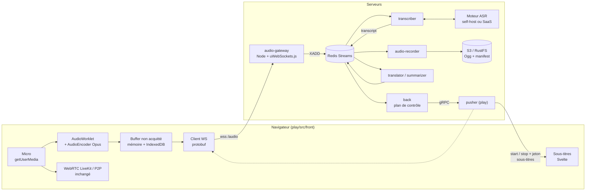
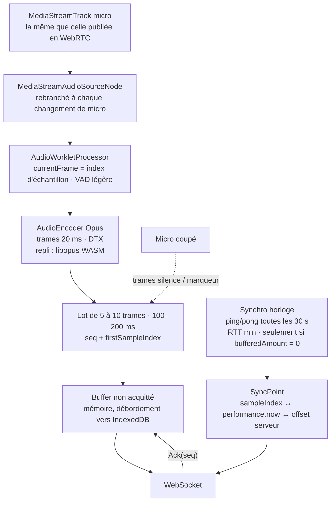
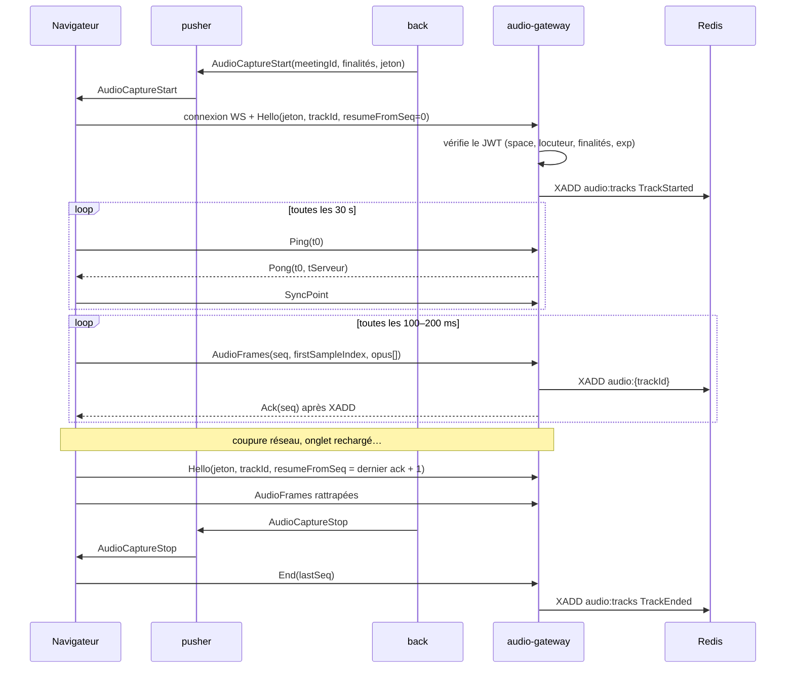
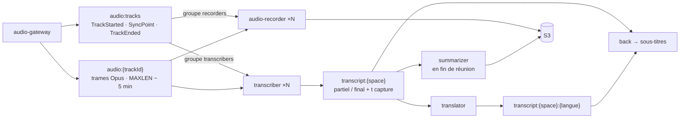
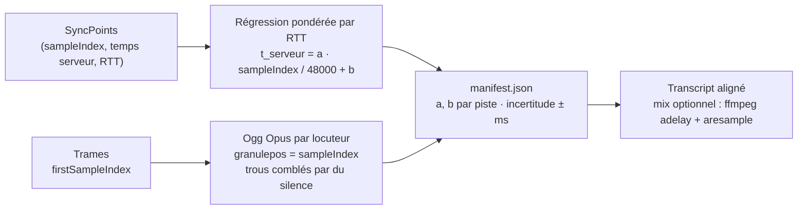
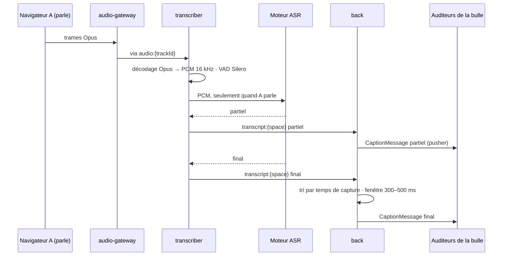
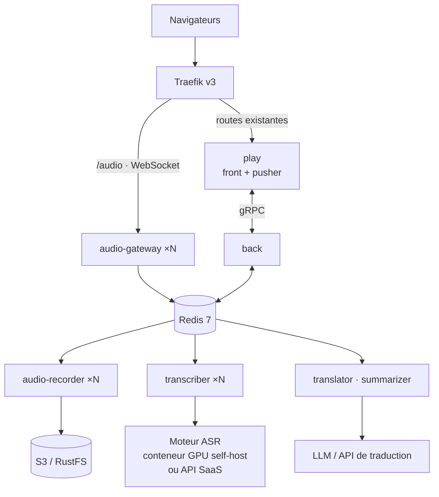

# Handoff — Capture audio côté navigateur (bus audio temps réel)

> Document de passation d'une session d'étude. Aucun code de production n'a encore été écrit.
> Branche : `claude/livekit-browser-recording-blm9wd`.
> Page d'architecture (privée, à partager depuis son menu Partager) : https://claude.ai/artifact/9rCgiCcqFXnBTA2DTCXf7z

## 1. Le sujet en une phrase

Sortir l'auto-record de LiveKit (track egress) : chaque navigateur encode **son propre micro** en Opus et le diffuse en continu
vers une passerelle. Le même flux sert ensuite de socle à l'enregistrement, aux sous-titres live, à la traduction et au résumé.

## 2. Ce qui existe aujourd'hui

| Élément | Où | Rôle |
|---|---|---|
| `AutoRecorder` | `back/src/Model/AutoRecorder.ts` | Un track egress LiveKit par micro → `auto-recordings/<world>/<room>/<date>/<meeting>/<user>-<ms>.ogg` + `manifest.json` à la fin |
| `LivekitService.startTrackEgress` / `getEgressFile` | `back/src/Model/Services/LivekitService.ts` | Lance l'egress ; l'alignement repose sur `startedAt` de l'egress (« une seconde ou deux » d'incertitude, dixit le code) |
| `TransitionPolicy` | `back/src/Model/Policies/TransitionPolicy.ts:46` | **Force LiveKit** pour un espace enregistré, même une bulle à 2 qui serait en P2P |
| Scripting audio entrant | `play/src/front/WebRtc/AudioStream/ScriptingInputAudioStreamManager.ts`, `InputPCMStreamer.ts`, `InputAudioWorkletProcessor.ts` | PCM des **autres** participants, mixés, envoyé au script (`meeting.listenToAudioStream`) |
| Scripting audio sortant | `ScriptingOutputAudioStreamManager.ts`, `OutputPCMStreamer.ts` | Un script injecte de l'audio dans la réunion (`meeting.startAudioStream` + `appendAudioData`), en P2P comme en LiveKit |
| Infra existante | `docker-compose.yaml` | Traefik v3, Redis 6, play (front + pusher, uWebSockets.js), back (gRPC), S3 / RustFS |

Aucune génération de résumé n'a été trouvée dans ce repo : hypothèse retenue, le résumé est produit **en dehors** à partir des fichiers
`auto-recordings/` et du `manifest.json`. **À confirmer.**

## 3. Décisions prises pendant l'étude

1. **Capture dans le navigateur, avant le réseau** : pas de pertes de paquets, pas de baisse de débit, meilleure qualité pour l'ASR.
2. **Stream temps réel plutôt qu'upload de chunks**, mais avec seq / ack / reprise (sinon une coupure = un trou).
3. **WebCodecs `AudioEncoder` plutôt que `MediaRecorder`** : on envoie des trames Opus brutes horodatées en échantillons ;
   le serveur gère le conteneur, donc reprise et changement de micro ne cassent pas le fichier.
4. **Horodatage à la capture (index d'échantillon), jamais à l'arrivée** : la latence et le jitter n'affectent pas la timeline.
5. **Le back reste l'autorité** (qui est capté, pour quelles finalités), comme `AutoRecorder` aujourd'hui.
6. **Priorité = parité** avec l'auto-record actuel (mêmes fichiers, même manifest, résumé inchangé). Le reste ensuite.
7. **L'egress reste** comme repli pendant la transition, puis seulement pour un éventuel mode « conformité »
   (le client n'est pas une source de confiance : il peut couper ou falsifier sa capture).

## 4. Technologies retenues

| Brique | Choix | Repli / alternative |
|---|---|---|
| Capture | `AudioWorklet` + WebCodecs `AudioEncoder` (Opus 48 kHz mono, trames 20 ms, 32–48 kb/s, DTX) | libopus WASM si `AudioEncoder` absent (support Safari / Firefox **à vérifier**) |
| Transport | WebSocket binaire dédié, protobuf (ts-proto, déjà utilisé) | WebTransport plus tard |
| Passerelle | `audio-gateway` (nouveau) Node/TS + uWebSockets.js | Go si densité de connexions |
| Auth | JWT court signé par le back : space, meeting, locuteur, finalités, exp | — |
| Bus interne | Redis Streams (Redis déjà là ; passer de 6 à 7.x) | NATS JetStream au-delà de ~50 000 msg/s |
| Enregistrement | `audio-recorder` (nouveau) Node/TS, muxer Ogg Opus maison (granulepos = index d'échantillon), `@aws-sdk/lib-storage` | — |
| Transcription | `transcriber` (nouveau) Node/TS + interface fournisseur, VAD Silero | — |
| Moteur ASR | Self-host : faster-whisper (Speaches / WhisperLive) ou Voxtral sur GPU. SaaS : Deepgram, Speechmatics, Azure | — |
| Sous-titres | back → pusher → front via les messages de space existants | — |
| Traduction / résumé | `translator`, `summarizer` (nouveaux) ; LLM, DeepL ou LibreTranslate | — |
| Horloge serveur | chrony / NTP sur tous les hôtes | — |
| Observabilité | Prometheus + Sentry (existant) | — |

## 5. Schémas

### 5.1 Vue d'ensemble



### 5.2 Pipeline navigateur



### 5.3 Protocole et reprise



Messages à ajouter dans `messages/protos/` :

```proto
// audio_ingest.proto
message AudioClientMessage {
  oneof message {
    Hello hello = 1;
    AudioFrames frames = 2;
    Ping ping = 3;
    SyncPoint sync = 4;
    End end = 5;
  }
}
message Hello       { string token = 1; string trackId = 2; uint64 resumeFromSeq = 3; uint32 sampleRate = 4; }
message AudioFrames { uint64 seq = 1; uint64 firstSampleIndex = 2; repeated bytes opus = 3; bool silence = 4; }
message SyncPoint   { uint64 sampleIndex = 1; double clientPerfNowMs = 2; double serverOffsetMs = 3; double rttMs = 4; }
message Ping        { double clientPerfNowMs = 1; }
message End         { uint64 lastSeq = 1; }

message AudioServerMessage {
  oneof message {
    Ack ack = 1;      // uint64 seq : tout ce qui précède est dans Redis
    Pong pong = 2;    // double clientPerfNowMs, double serverTimeMs
    Stop stop = 3;    // révocation : finalité retirée, jeton expiré
  }
}
```

### 5.4 Bus Redis et consommateurs



| Stream | Contenu | Rétention | Lu par |
|---|---|---|---|
| `audio:tracks` | Ouverture / fermeture des pistes, points de synchro, finalités | 24 h | Consumer groups : un recorder et un transcriber prennent chaque piste |
| `audio:{trackId}` | Lots de trames Opus + `seq` + `firstSampleIndex` | ~5 min (`MAXLEN ~`) | Le recorder et le transcriber de la piste |
| `transcript:{space}` | `(locuteur, début, fin, texte, partiel/final)` en temps serveur | Durée de la réunion | back, translator, summarizer |
| `transcript:{space}:{langue}` | Segments traduits, une fois par langue demandée | Durée de la réunion | back |

- Chemin **live** (transcriber) : ignore les trames rattrapées. Chemin **durable** (recorder) : les remet à leur place.
- Crash d'un consommateur : reprise des messages en attente par une autre instance (`XAUTOCLAIM`, Redis 6.2+).

### 5.5 Horloge et reconstruction



| Source d'erreur | Impact | Parade |
|---|---|---|
| Latence / jitter / reprise | Aucun sur la timeline | Horodatage à la capture |
| Asymétrie réseau (offset) | 5–50 ms en pratique (max RTT/2) | Échantillons au RTT minimal, régression, mesure quand `bufferedAmount = 0` |
| Dérive de la carte son | ~180 ms/h à 50 ppm | Points de synchro + pente `a` de la régression |
| Latence conversationnelle | Inhérente, ~100–300 ms | Aucune, et pas nécessaire pour la transcription |
| Ordre des sous-titres | Visible en live | Fenêtre de réordonnancement 300–500 ms côté back |

### 5.6 Sous-titres live



### 5.7 Déploiement



Ordre de grandeur : 64 kb/s par locuteur actif, soit ~64 Mb/s et 5 000 à 10 000 messages Redis/s pour 1 000 personnes qui parlent
en même temps. Le poste dominant est le moteur ASR, pas le transport.

## 6. Réutilisation de l'API de scripting

**À réutiliser pour la capture :**
- Chargement du worklet + `audioContextManager` (`?worker&url`), à 48 kHz.
- Gestion des pistes de `InputPCMStreamer` (ajout / retrait / `ended`) : c'est le « rebrancher la source quand on change de micro ».
- Le suivi des bascules P2P ↔ LiveKit de `peerAudioStreams()` (`ScriptingInputAudioStreamManager.ts:88`), appliqué au micro local.
- `startAudioStream` / `OutputPCMStreamer` = **chemin de retour** déjà existant (agent IA qui parle, traduction doublée), sans LiveKit.

**À adapter** (faire un `CaptureWorkletProcessor` voisin plutôt que modifier celui du scripting, et factoriser la gestion des pistes) :
- Le worklet actuel **mixe** toutes les entrées → on veut une seule piste, le micro local.
- Il poste toutes les 128 échantillons (~375 msg/s) → regrouper par trames de 20 ms (960 échantillons) avant l'encodeur.
- Il ne compte pas les échantillons → utiliser `currentFrame` (scope global du worklet) ; `audioContext.getOutputTimestamp()` relie
  temps audio et `performance.now()` pour les SyncPoints.

**Nouvelles API de scripting possibles** (phase 3+), alimentées par le bus — aujourd'hui un script qui transcrit le fait sur un mix
(pas de diarisation) et chez **chaque** participant (coût multiplié) :

| API | Contenu |
|---|---|
| `meeting.onTranscript(cb)` | Segments partiels / finaux : locuteur, début, fin, texte, langue |
| `meeting.captions.setLanguage("en")` | Traduction faite une fois par langue côté serveur |
| `meeting.onSpeakingChanged(cb)` | Événements VAD : temps de parole, mise en avant du locuteur |
| `listenToAudioStream(rate, { perSpeaker: true })` | Pistes séparées au lieu du mix |
| Room API : `listenToTranscript` | Intégrations serveur sans navigateur |

Point d'attention : `listenToAudioStream` donne **déjà** l'audio brut des autres à n'importe quel script de carte (code tiers).
Cadrer : permission déclarée par la carte et validée par l'admin du monde, indicateur visible, même logique de finalités.

## 7. Phases

| Phase | Objectif | Contenu |
|---|---|---|
| **1 · Parité** | Mêmes fichiers, même résumé | Capture WebCodecs + buffer + reprise ; audio-gateway + Redis + audio-recorder ; **même chemin S3** et **même `manifest.json`** (nouveaux champs uniquement optionnels : correspondance d'horloge, incertitude, `source: "browser"`) ; activation par monde, egress en repli ; double enregistrement sur quelques mondes pour comparer. La contrainte LiveKit est **gardée** pendant cette phase. |
| **2 · Gain** | Enregistrer en P2P | Retirer la contrainte LiveKit de `TransitionPolicy` ; retrait de l'auto-record par egress (egress seulement en mode « conformité ») |
| **3 · Live** | Transcription + sous-titres | transcriber + interface fournisseur ; un moteur self-host et un SaaS ; `CaptionMessage` + affichage Svelte ; indicateur de capture par finalité ; API de scripting transcript |
| **4 · Usages** | Traduction, analytics, résumé live | translator par langue ; résumé à partir du transcript live ; temps de parole, interruptions |

## 8. Questions ouvertes

1. Où et comment le **résumé** est-il produit aujourd'hui ? (Hypothèse : hors repo, à partir du bucket.) Si c'est à construire, l'ajouter
   à la phase 1 en batch (transcription + LLM en fin de réunion).
2. **Support WebCodecs `AudioEncoder` Opus** sur les versions Safari / Firefox ciblées → décide si le repli libopus WASM est nécessaire dès la phase 1.
3. **Montée de Redis 6 → 7** dans les docker-compose et chez les auto-hébergeurs.
4. **Modèle de consentement** par finalité (enregistrement ≠ sous-titres, RGPD) et indicateurs UI.
5. Choix du **moteur ASR self-host** par défaut (contraintes GPU des auto-hébergeurs).
6. Nom et emplacement des nouveaux services dans le monorepo (`audio-gateway/` à la racine comme `back/`, ou sous `play/`).

## 9. Prochaines étapes concrètes (phase 1)

1. Spike navigateur : `CaptureWorkletProcessor` + `AudioEncoder` sur le micro local, vérifier `currentFrame`, la continuité au changement
   de micro et au mute, et le support Safari / Firefox.
2. `messages/protos/audio_ingest.proto` + génération ts-proto.
3. `audio-gateway` : WS uWebSockets.js, validation JWT, `XADD`, ack, reprise, ping/pong.
4. Back : émission du jeton et de `AudioCaptureStart/Stop` depuis la logique d'`AutoRecorder` (activation par monde, egress en repli).
5. `audio-recorder` : consumer group sur `audio:tracks`, muxer Ogg Opus, upload S3 au même chemin, `manifest.json` compatible.
6. Tests : unitaires (vitest) sur muxer, régression d'horloge et protocole de reprise ; un e2e Playwright bulle à 2 avec coupure réseau.

## 10. Prompt de reprise pour une nouvelle session

> Lis `docs/others/internals/browser-audio-capture-handoff.md` sur la branche `claude/livekit-browser-recording-blm9wd`.
> On part sur la phase 1 (parité avec l'auto-record actuel). Commence par l'étape 1 de la section 9 (spike de capture navigateur)
> et réponds d'abord aux questions ouvertes 1 et 2 de la section 8.
