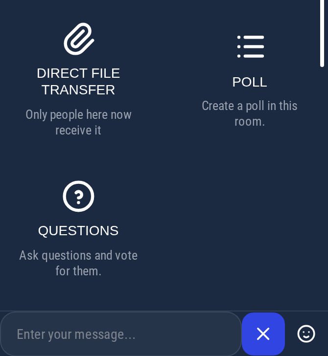
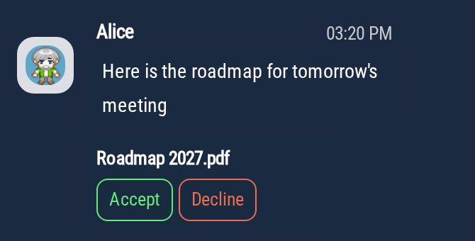
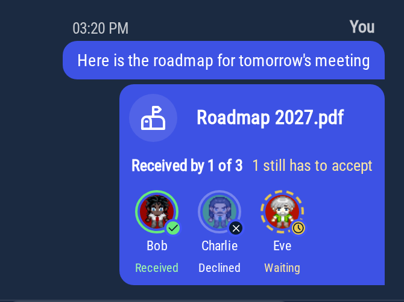

# Sharing files

You can send files in the chat: documents, images, videos or audio. How the file reaches the others depends on where you send it.

|                         | Chat rooms                                            | Proximity chat                                     |
|-------------------------|-------------------------------------------------------|----------------------------------------------------|
| Who receives the file   | The members of the room                               | The people in your bubble or meeting room right now |
| People who arrive later | Can see it, depending on the room's history settings  | Don't get it                                       |
| Stored on a server      | Yes, in the room history                              | No, it goes straight from your browser to theirs   |
| Limits                  | File size set by the chat server                      | 10 people, 100 MB per file, 3 files at a time      |

## Sending a file

1. In the chat, click **+** next to the message box.
2. Click **File attachment** in a chat room, or **Direct file transfer** in the proximity chat.
3. Choose one or more files.

You can also drag files onto the conversation, or paste them into the message box.

:::note
If the button is greyed out, file sharing is turned off for your world. Administrators can
turn it on in the [chat settings](/admin/chat#enable-or-disable-file-upload-in-chat).
:::

## In chat rooms

The file is uploaded to the chat server and stays in the room history, like the messages. Members of the room can open
or download it whenever they want, even if they were not connected when you sent it.

Whether people who join the room later can see it depends on the room's **Who can read history** setting (see
[Creating a chat room](/user/chat#creating-a-chat-room)).

Images, videos and audio files are displayed directly in the conversation. Other files come with a download link.

## In the proximity chat: direct file transfer

Like the messages of the [proximity chat](/user/chat#proximity-chat-room), files sent there are **not stored**. The
file goes directly from your browser to the browser of each person in your bubble or meeting room. The connection is
encrypted. When a direct connection is not possible, the file goes through a relay server that passes it along without
keeping it.

### Who receives the file

Only the people who are in your bubble or meeting room when you send the file. Someone who joins afterwards does not
get it: send it again if they need it. People you have blocked do not receive your files.

### Receiving a file

The file appears in the chat with an **Accept** and a **Decline** button. Nothing is downloaded until you click
**Accept**. The chat then shows the progress and the estimated time left.

Once the file is received, images, videos and audio files are displayed directly in the conversation. Other files come
with a download link.

:::caution
Save the file before you leave the bubble or meeting room. Once you leave, the file is no longer available.
:::

### Following the transfer

Under the file you sent, each person appears with their avatar and a status:

- **Waiting** (yellow clock): they have not accepted the file yet.
- A ring that fills up around their avatar, with a percentage: the file is being sent to them.
- **Received** (green check): they have the file.
- **Declined**: they declined the file.
- **Not delivered** (red "!"): the transfer was interrupted, for example because they left the bubble.

The line above the avatars sums it up, for example "Received by 2 of 3" and "1 still has to accept".

:::caution Stay until everyone has received the file
The file is sent from your browser. If you leave the bubble or meeting room, or close the tab, before everyone has
received it, the people still waiting will not get it.
:::

### Limits

- Direct file transfer is available when there are **10 people or fewer** in the bubble or meeting room, you included.
  Above that, the button is greyed out.
- Each file can be up to **100 MB**.
- You can send up to **3 files at a time**.
