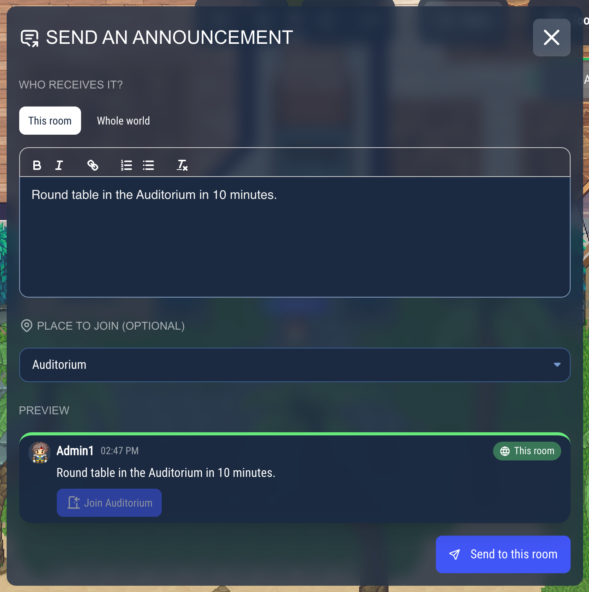
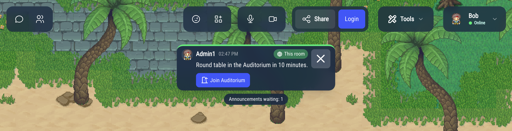

# Sending a message to everyone

Administrators can send an announcement to everyone connected to their room, or to the whole world: to announce the start of a conference, a fire drill, the end of the day…

Only users with the `admin` tag can send them. To broadcast your camera and microphone live instead, use **Go live**, the [megaphone](/map-building/inline-editor/megaphone).

## Sending an announcement

1. Click **Tools** in the action bar, then **Send an announcement**.
2. Choose who receives it: **This room**, or **Whole world** to reach every room of your world.
3. Write your message. The toolbar formats the text (bold, italic, links, lists).
4. Optionally, pick a **Place to join**: a named area of the current map. The announcement then carries a **Join** button.
5. Check the **Preview**: it shows the card exactly as people will receive it.
6. Click **Send to this room**, or **Send to the whole world** and confirm.

## Receiving an announcement

Everyone connected to the room (or to the world) sees the announcement below the action bar, with a short sound. It shows who sent it, at what time, and whether it went to the room or the whole world. They close it with the cross or **Escape**.

When it has a place, **Join** walks their Woka to that area. From another room of the world, it takes them to the right map first, without reloading the page. If the area was renamed or deleted in the meantime, a message says the place no longer exists.

When several announcements arrive, the newest one is shown and a counter tells how many are waiting behind it.

## Good to know

- Only the people connected at that moment receive the message: it is not kept.
- You also receive your own message.
