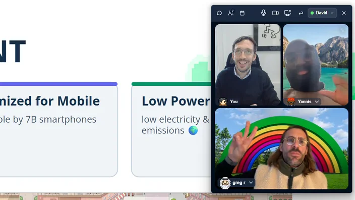

## Kéo bản đồ để nhìn xung quanh

Nắm lấy bản đồ và kéo để xem những gì đang diễn ra ở nơi khác mà không cần di chuyển Woka của bạn. Camera sẽ quay lại Woka ngay khi Woka bắt đầu đi. Trên màn hình cảm ứng, hãy kéo bằng một ngón tay và chạm vào nơi bạn muốn đến.

---

## Ứng dụng máy tính (beta)

Khi có người đến nói chuyện với bạn trong lúc bạn làm việc trong một ứng dụng khác, một cửa sổ thu nhỏ hiện ra với cuộc trò chuyện, phía trên mọi ứng dụng và trên mọi màn hình. Bạn thấy ngay ai đang ở đó và có thể trả lời mà không cần tìm đúng thẻ. [Tải xuống](https://workadventu.re/download/) cho Windows, macOS hoặc Linux.

### Cũng có trong phiên bản này

- Trạng thái "Không hoạt động" tắt camera và micrô của bạn khi bạn vắng mặt
- Trò chuyện được thiết kế lại, với tính năng @nhắc tên và thông báo đã xem
- Chú thích trên màn hình được chia sẻ
- Phím tắt mà bạn có thể thay đổi

Đọc [ghi chú phát hành đầy đủ](https://workadventu.re/release/workadventure-1-35-drag-the-map-desktop-app-and-redesigned-chat/) để biết mọi chi tiết.
